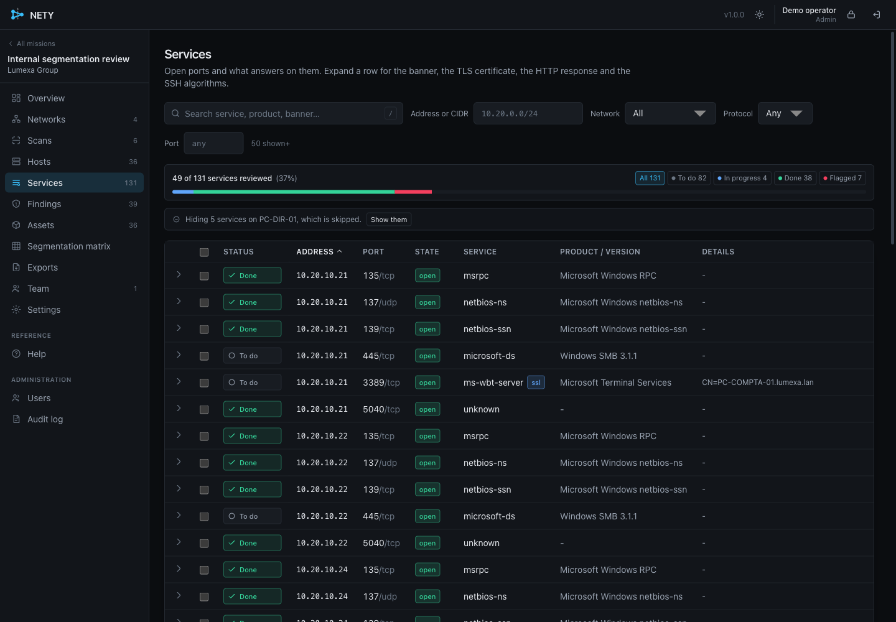
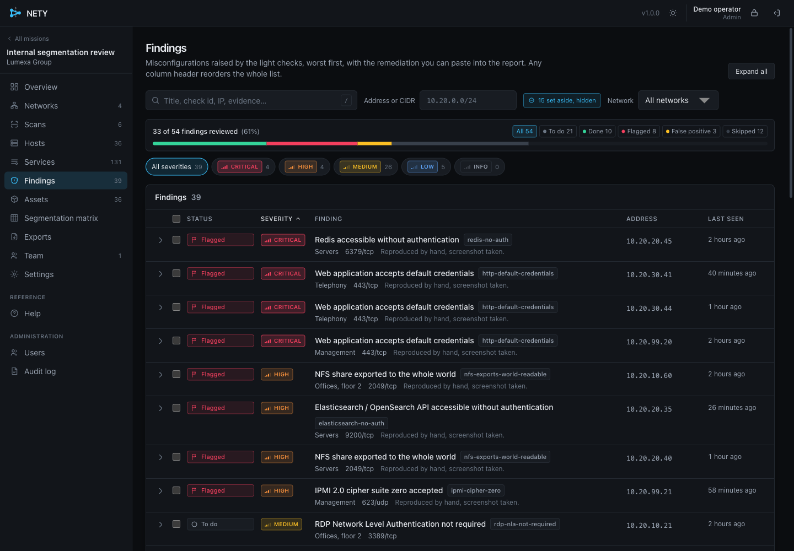

<div align="center">


**Network segmentation testing for internal pentests. Measured, not assumed.**

Map every segment you can reach (VLANs, firewall zones, subnets), then find
out which of them can actually talk to each other.

[](https://github.com/GoToolSharing/nety/actions/workflows/ci.yml)
[](https://github.com/GoToolSharing/nety/releases/latest)
[](LICENSE)

</div>

You plug in somewhere, NETY maps that segment and fingerprints everything on
it. You move to the next one and repeat. Then, from any one of them, it
replays every service it found elsewhere and tells you exactly which flows
cross the boundary, by plain routing or by working around the filtering.

A VLAN on its own filters nothing: it is a layer-2 split of a broadcast
domain. What actually holds, or does not, is the layer-3 filtering between
segments, and that is the same test whether the boundary is a VLAN, a firewall
zone, a DMZ or a guest SSID. The VLAN-specific part, the passive CDP, LLDP and
DTP recon and the 802.1Q hopping techniques, is there too, and is simply
skipped where there is no switch port to read.

One static Go binary, an authenticated web interface, and no `nmap` or
`masscan` subprocess: the scanning is native, so results stream out as they are
found instead of landing in a file at the end. A colleague on the same network
opens your IP in a browser, signs in, and watches the same scan live.


## Install

Grab the archive for your architecture from the
[latest release](https://github.com/GoToolSharing/nety/releases/latest) and run
the installer on the Linux machine you will scan from:

```sh
tar xzf nety-v1.0.0-linux-amd64.tar.gz
cd nety-v1.0.0-linux-amd64
sudo ./install.sh
```

It installs a systemd service, grants it `CAP_NET_RAW` and `CAP_NET_ADMIN`,
creates the data directory and prints the URL and the first admin password.
Running it again upgrades in place and never touches the database.

Building it yourself needs only Docker, so Go and Node stay off your machine:

```sh
make build   # static linux/amd64 and linux/arm64 binaries in ./dist
make test    # the whole test suite
```

## How it works

### 1. One network per segment

Declare each point you attach to: a VLAN access port, a firewall zone, a plain
subnet.

On a switch port there is a passive layer-2 capture as well, reading CDP and
LLDP, the native and voice VLAN, the 802.1Q tags on the wire, and whether the
port offers DTP. A port that negotiates trunking is a finding in itself. Where
there is no switch port, over Wi-Fi or behind a firewall, that step is skipped
and everything else works the same.


### 2. Run a discovery scan

Host discovery, TCP and UDP port scan, service fingerprinting, identity
collection and the misconfiguration checks. Every phase is a queue of persisted
work units: pause it, shut the laptop, resume tomorrow, and it continues
exactly where it stopped. Kill the process mid-scan and it comes back as
*paused*, not lost.


### 3. Repeat on every segment

Move the cable, add a network, scan again. Machines keep one identity across
days and IP changes: NETY correlates the SMB server GUID, SNMP engine ID, SSH
host keys, the NetBIOS adapter MAC and TLS certificates into long-lived
*assets*, so a re-scan refreshes yesterday's inventory instead of producing a
brand-new one.

### 4. Test the segmentation

From where you are plugged in now, every service discovered on the other
segments is retried, several ways each: plain routing, ICMP, privileged source
ports, IPv6, an alternate gateway, fragmentation, and, where the boundary is a
VLAN and you enable them, 802.1Q and DTP. The matrix is the deliverable.


### 5. Work through the results

Deciding whether each open port is really a problem is still manual. Mark a
service or a finding **to do**, **in progress**, **done**, **flagged**, a
**false positive** or **skipped**, alone or in batches, and write what you
tested. Skipping a machine takes its services, findings and segmentation
results out of the way without deleting anything.



Findings carry the remediation you can paste into the report, and what you have
set aside is hidden by default, so what is left to look at stays visible.



### 6. Export

JSON, CSV, Nmap XML, greppable Nmap, an `ip:port` list, Markdown, a
self-contained HTML report and an Excel workbook. What you set aside, and the
findings you have not reviewed, stay out of the deliverable unless you ask for
them; either way the file says on its front page how many rows it held back.

A whole mission can also be exported as a bundle and restored elsewhere, with
the triage, the notes and the pending work units intact.

## What it does

| | |
|---|---|
| **Native scanning** | Stateless SYN with AF_PACKET and BPF, connect fallback, UDP with protocol payloads. No subprocess. |
| **Live results** | Every host, port, service and finding is persisted and pushed to the browser the moment it is found. |
| **Resumable** | A scan is a queue of work units. Pause, crash or reboot, it picks up where it stopped. |
| **Stable identities** | Machines keep one entry across days, IP changes and segments. |
| **65 checks** | SMB signing, null sessions, anonymous LDAP, open Redis and Mongo, IPMI cipher zero, exposed admin consoles, weak TLS and more. |
| **Segmentation matrix** | Reachability measured, not assumed, with the technique that got through named. |
| **Multi-user** | Accounts, roles, an audit log, and a shared live view. |

## Documentation

- [`docs/DEPLOY.md`](docs/DEPLOY.md): installing it on the Linux box you will
  scan from, what it does and does not touch, and the Proxmox network settings
  VLAN work needs
- [`docs/OPERATIONS.md`](docs/OPERATIONS.md): the field manual: privileges,
  reading a result, the bypass techniques, tuning, sharing, troubleshooting
- [`docs/ARCHITECTURE.md`](docs/ARCHITECTURE.md): how it is put together
- [`docs/API.md`](docs/API.md): the HTTP contract

## Scope and safety

Only scan what you were asked to scan. The mission carries a scope and an
exclusion list, enforced on every phase. The intrusive parts, vendor default
credentials and the layer-2 techniques, are off until you turn them on. Routes
and sub-interfaces NETY creates on your own machine are reverted when a test
ends, is cancelled, or the process shuts down.

## Licence

[GNU General Public License v3.0](LICENSE).
