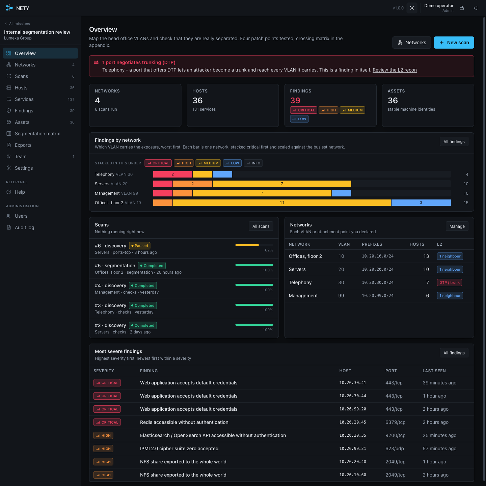
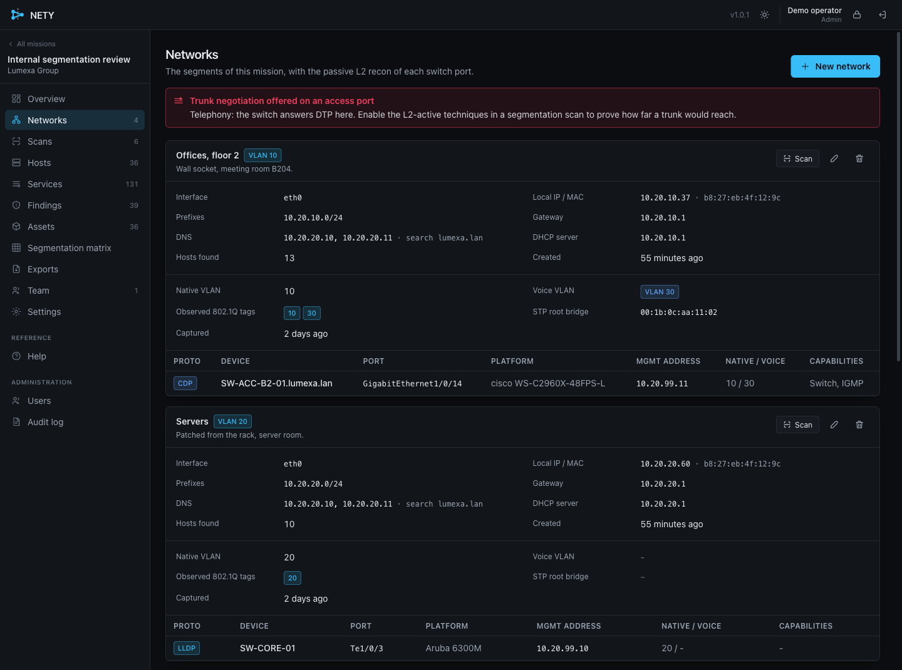
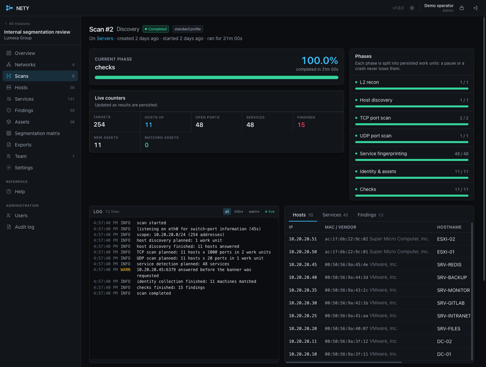
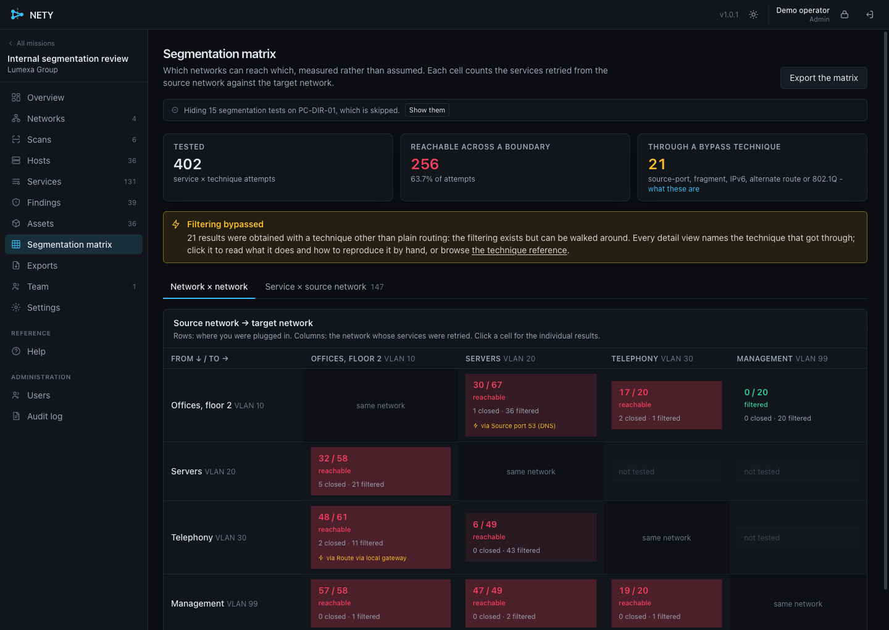
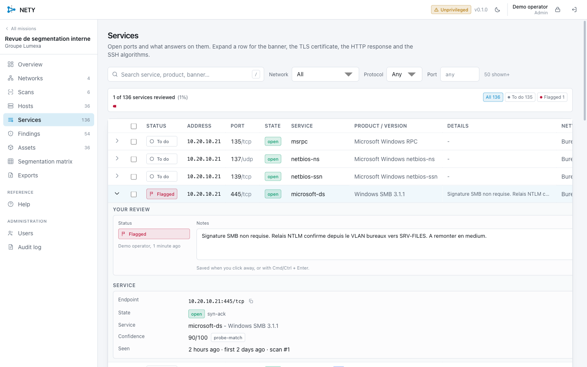
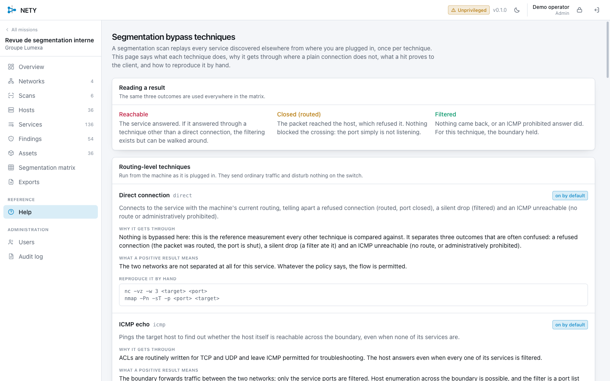

# NETY

**Map every VLAN on an internal pentest, then measure which ones can actually
reach each other.**

You plug into a switch port, NETY maps that segment and fingerprints everything
on it. You move to the next VLAN and repeat. Then, from any one of them, it
replays every service it found elsewhere and tells you exactly which flows
cross the boundary, by plain routing or by working around the filtering.

One static Go binary, an authenticated web interface, and no `nmap` or
`masscan` subprocess: the scanning is native, so results stream out as they are
found instead of landing in a file at the end.



---

## Why

A segmentation review usually means scanning VLAN A, copying the output
somewhere, scanning VLAN B, and reconciling files by hand. Three things hurt,
and NETY is built around them.

**Results arrive at the end.** A scan that dies at 80% leaves nothing. Here
every host, port, service and finding is written and pushed to the browser the
moment it is found.

**Nothing is resumable.** A scan is a queue of persisted work units. Pause it,
shut the laptop, resume tomorrow: it continues exactly where it stopped. Kill
the process mid-scan and it comes back as *paused*, not lost.

**Machines lose their identity.** DHCP reshuffles everything overnight and
yesterday's inventory no longer lines up. NETY collects evidence that outlives
an IP change (SMB server GUID, SNMP engine ID, SSH host keys, the NetBIOS
adapter MAC, certificates) and correlates it into long-lived *assets*.

And it is a platform, not a CLI: a colleague on the same VLAN opens your IP in
a browser, signs in with their own account and watches the same scan live.

---

## The workflow

### 1. Create a mission, then a network per VLAN

A *mission* is one engagement. Inside it, each VLAN you plug into is a
*network*. Pick the interface and press detect: NETY reads the addressing,
gateway, DNS and DHCP lease for you.



It also listens passively for CDP, LLDP, DTP, STP and 802.1Q tags. That tells
you who the switch is, what the port is configured for, and whether it offers
to negotiate a trunk. A port that does is a finding on its own, and the
interface says so in red.

### 2. Run a discovery scan

Pick a profile (*Standard* covers most cases) and start. The scan runs in
phases, each one a queue of work units:

```
L2 recon -> host discovery -> TCP ports -> UDP ports
         -> fingerprinting -> identity and assets -> checks
```



Watch it fill. Hosts appear as they answer, ports as they open, services as
each one is identified. Pause and resume at any point; the phase breakdown on
the right is the real work-unit state, not an estimate.

### 3. Repeat on every VLAN

Unplug, move, create the next network, scan again. Assets correlate across
networks and across days, so the same machine stays one entry.

### 4. Test the segmentation

Back on any VLAN, start a **segmentation** scan. NETY replays every service it
knows about on the other networks, once per technique, and fills the matrix.



Each cell says how many services were reachable out of how many were tried, and
whether any of it needed a bypass. The numbers are measured, not inferred from
a config.

### 5. Work through the services

A scan says what is exposed. Deciding whether each service is a problem is
still your job, one port at a time. Each service carries a status and a note.



Mark a service or a finding **to do**, **in progress**, **done**, **flagged**,
a **false positive** or **skipped**, alone or in batches, and write what you
tested. Skipped and false positive are kept apart on purpose: one says you are
not spending time on it, the other says the check is wrong. Both are hidden by
default from the findings list and left out of the overview's counters, with
the number of hidden rows always on screen. A host or a machine is simply in
scope or out of it.

This is yours, not the scanner's: re-running a scan tomorrow refreshes what was
observed and leaves every status and note intact.

### 6. Export

JSON, CSV (hosts, services, findings, segmentation, assets, matrix), Nmap XML,
greppable Nmap, a bare `ip:port` list, Markdown, a self-contained HTML report
and an Excel workbook.

The services CSV and the Excel sheet carry your status, note, author and
timestamp next to the service itself, because that sheet is what ends up in the
client's tracker.

---

## Reading a result

Three outcomes, used everywhere:

| | Meaning |
|---|---|
| **Reachable** | The service answered. The boundary did not hold for this flow. |
| **Closed (routed)** | The packet reached the host, which refused it. Nothing blocked the crossing; the port simply is not listening. |
| **Filtered** | Nothing came back, or an ICMP prohibited answer did. The boundary held. |

The distinction between *closed* and *filtered* is the whole point: one means
routing works and the service is absent, the other means the filtering works.

---

## Bypass techniques

A segmentation scan tries each service several ways. The interface has a
**Help** page describing all of them, with the manual command to reproduce
each one.



**Routing level**, on by default, nothing is changed on the switch:

| Technique | Why it sometimes works |
|---|---|
| `direct` | The reference measurement everything else is compared against. |
| `icmp` | ACLs are written for TCP and UDP and leave ICMP open for troubleshooting. |
| `src-port-53/88/123/20/67/500` | Stateless rules often permit anything coming from DNS, Kerberos, NTP or DHCP source ports. |
| `ipv6` | IPv6 filtering is routinely forgotten while IPv4 is locked down. |
| `gateway-route` / `alt-gateway` | The router would forward it; the client simply has no route. Install one and ask again. |
| `ip-fragment` | Some stateless filters mishandle fragmented packets. |

**Layer 2**, off by default because they change switch-port state and can
disturb a switch:

| Technique | What it does |
|---|---|
| `dot1q-subif` | Builds a tagged sub-interface for the target VLAN and talks to it directly. |
| `dtp-trunk` | Asks the port to become a trunk, then does the above. Only worth trying where the passive recon saw DTP. |
| `double-tag` | Sends a doubly-tagged frame. One-way by nature, so a positive result is reported as *sent*, never as confirmed. |

Everything NETY changes on your machine (routes, sub-interfaces, trunk
negotiation) is tracked and reverted when a test ends, when it is cancelled,
and again at shutdown.

---

## Running it

```bash
make build      # static linux/amd64 and linux/arm64 binaries in ./dist
make test       # the whole test suite
```

Every target runs in Docker, so Go and Node stay off your machine.

To install it on the machine you will scan from, there is a release tarball
with a systemd unit and an installer:

```bash
make release                                  # or ARCH=arm64
scp dist/release/nety-*-linux-amd64.tar.gz user@host:
ssh user@host 'tar xzf nety-*.tar.gz && cd nety-*-linux-* && sudo ./install.sh'
```

See [`docs/DEPLOY.md`](docs/DEPLOY.md) for the detail, including what it does
and does not change on a machine that is already busy.

First start prints an administrator password once. The log lists the URLs a
colleague on the same VLAN can reach you on.

### Where you can run it

| Environment | Connect scan | SYN, ARP, L2 recon | 802.1Q, DTP |
|---|---|---|---|
| Linux, native | yes | yes | yes |
| Linux VM, bridged to a USB-Ethernet adapter | yes | yes | usually |
| Linux VM, NAT | yes | inside the virtual network only | no |
| macOS, native | yes | no | no |

Architecture does not matter: the binary is built for arm64 and amd64 and
Rosetta is never involved. What matters is access to layer 2. A VM bridged onto
a wired adapter covers nearly everything; only trunk work really wants a native
Linux host.

Wi-Fi behaves exactly like a cable for everything that rides on IP. Only the
switch-port techniques drop out, since an access point does not carry tagged
frames to a station or speak DTP, and NETY says so rather than failing
obscurely.

### Sharper version detection

If `nmap` is installed, point NETY at its probe database. The file is read at
runtime and never bundled:

```bash
nety serve --nmap-probes /usr/share/nmap/nmap-service-probes
```

Without it, detection still works through TLS, HTTP and SSH inspection plus
banner heuristics, just less precisely on exotic services.

---

## Trying it without a client network

Three Docker "VLANs" with real services:

```bash
make lab-up
docker compose -f build/lab/docker-compose.yml logs -f nety   # admin password
open https://localhost:8443/
```

Docker bridges forward between each other by default, so the lab's matrix
legitimately shows VLAN 10 reaching VLAN 20. That is what an unsegmented
network looks like.

To browse a filled-in interface without scanning anything, a separate generator
invents an engagement. It is never run by `nety serve`:

```bash
go run ./cmd/netydemo -data ./demo-data
nety serve --data ./demo-data --no-tls --listen 127.0.0.1:8080
```

A normal install starts empty: no mission, no host, just the administrator
account you were given at first start.

### What is proven, and what is not

`make verify-kernel` exercises, against a real kernel in a throwaway container,
what unit tests cannot reach: creating and tearing down 802.1Q sub-interfaces,
the DTP frame checked byte for byte against the protocol, and a real tagged
data path over a veth pair across two network namespaces with NETY's own
scanner finding a service through the tag.

What still needs physical hardware is whether a switch *grants* a trunk in
response to DTP. The frame is verified correct and everything after a granted
trunk is verified working; the switch's reply is the one untested step, and it
fails safe.

---

## Scope and safety

NETY is for **authorised** internal security assessments.

- Every check is read-only. The only credential attempts are a short vendor
  default list, off unless you enable it, capped so nothing gets locked out.
- The layer-2 techniques are off by default, behind an explicit toggle.
- Your own address and the mission's exclusions are never scanned, including
  by a segmentation scan.
- Every action is written to an audit log: who, what, which client, from where.

Get written authorisation before pointing this at anything.

---

## More

- [`docs/DEPLOY.md`](docs/DEPLOY.md) - installing it on the Linux box you will
  scan from, what it does and does not touch on that machine, and the Proxmox
  network settings VLAN work needs
- [`docs/ARCHITECTURE.md`](docs/ARCHITECTURE.md) - how it is put together and
  the rules every package follows
- [`docs/OPERATIONS.md`](docs/OPERATIONS.md) - the field manual: privileges,
  tuning, sharing, troubleshooting
- [`docs/API.md`](docs/API.md) - the HTTP contract

## Licence

See LICENSE.
