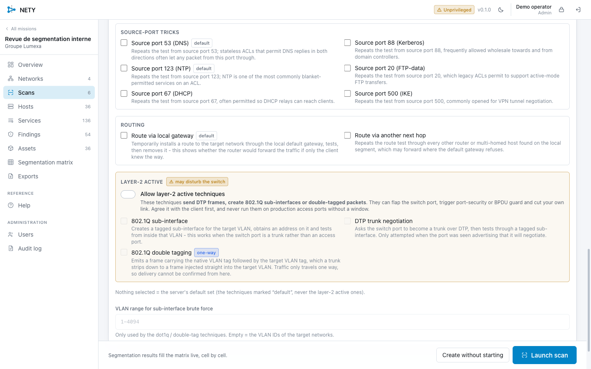

# Deploying NETY on a Linux VM

Target: a Linux VM (Proxmox or anything else) that you reach over SSH and that
is plugged into the network you want to audit.

## Native binary or Docker?

**Use the binary.** NETY talks to the network interfaces directly: raw sockets
for SYN scanning and ARP, netlink for creating 802.1Q sub-interfaces and
routes, promiscuous mode for the passive CDP/LLDP/DTP recon. A container buys
you nothing here:

- it needs `--net=host` anyway, so there is no network isolation left;
- it needs `--cap-add=NET_RAW --cap-add=NET_ADMIN`, so there is little
  privilege isolation left either;
- the sub-interfaces it creates land in the host's network namespace, so the
  container boundary is a fiction for exactly the part that matters;
- it is one 25 MB static binary with no runtime dependency. There is nothing
  to isolate it from.

Docker stays useful for the build and for the lab. For the machine that does
the scanning, install the binary and let systemd run it.

---

## 1. Build the release

On your workstation, in the repo. Everything runs in Docker, nothing is
installed locally.

```bash
make release                 # amd64, the usual Proxmox VM
make release ARCH=arm64      # if the VM is arm64
```

That produces `dist/release/nety-<version>-linux-<arch>.tar.gz` containing the
binary, the systemd unit, the installer and the docs.

## 2. Copy it over

```bash
scp dist/release/nety-*-linux-amd64.tar.gz user@vm:
```

## 3. Install

```bash
ssh user@vm
tar xzf nety-*-linux-amd64.tar.gz
cd nety-*-linux-amd64
sudo ./install.sh
```

The installer creates a `nety` system account, puts the binary in
`/usr/local/bin`, creates `/var/lib/nety` (mode 700), grants the three
capabilities, installs the unit, and starts the service. It is idempotent:
run it again to upgrade, your database is left alone.

It prints the administrator password on first start, and the URLs the service
is reachable on.

```
NETY is running.

First start. The administrator password was printed once, here:

    username: admin
    password: 7kPx2mNqRtVwYzAbCdEf

Reach it on:
  https://10.20.30.41:8443/
```

Open that in a browser. The certificate is self-signed; its fingerprint is in
the log, so you can tell a colleague what to expect:

```bash
journalctl -u nety | grep sha256
```

## 4. Check it has what it needs

```bash
curl -sk https://localhost:8443/api/status | python3 -m json.tool
```

Before logging in you only get the version. Once signed in, the interface shows
an **Unprivileged** badge in the header if raw sockets are missing. If you see
it, something is wrong with the capabilities:

```bash
getcap /usr/local/bin/nety
# /usr/local/bin/nety cap_net_bind_service,cap_net_admin,cap_net_raw=eip
systemctl show nety -p AmbientCapabilities
```

If `setcap` was missing at install time: `sudo apt install libcap2-bin`, then
re-run the installer.

---

## Can it break the machine it runs on?

Worth answering precisely before you install this next to something you care
about, such as a VM already running audit containers.

### What NETY never touches

The MAC address, the existing IP addresses, the existing routes, DNS, and any
interface it did not create. Nothing in a discovery scan writes to the network
configuration at all: host discovery, port scanning, fingerprinting, identity
collection and the checks only send packets and read replies.

### What it changes briefly, and puts back

| What | When | Risk to a co-tenant |
|---|---|---|
| Promiscuous mode on the interface | During the passive L2 recon, about 45 seconds per scan | None. It is a receive flag; it does not alter addressing or forwarding. Restored afterwards. |
| A temporary route to a target prefix | The `gateway-route` and `alt-gateway` techniques, during a segmentation scan | Very low, by design: the route is installed with metric 2048, so any legitimate route to the same prefix always wins, and NETY only installs one when no specific route already exists. Removed when the test group ends, and again at shutdown. |

Both are tracked and reverted on success, on error, on cancellation and on
shutdown, and the cleanup only ever removes what this process created: a
sub-interface or route that was already there is left alone.

### What genuinely can disturb things, and is off by default

The layer-2 techniques. They are opt-in per scan, behind an explicit toggle
with a warning, and they are the reason this section exists:

- **`dtp-trunk`** asks the switch port to become a trunk. If the switch agrees,
  **the port's configuration changes**, and that affects everything on that
  port, including the VM's existing networking and its containers. This is the
  one with real blast radius.
- **`dot1q-subif`** creates an `ethX.<vlan>` sub-interface and asks for a DHCP
  lease on the client's VLAN. It consumes a lease and shows up in the client's
  DHCP logs under the same MAC as the VM, since a VLAN sub-interface inherits
  its parent's address.
- **`double-tag`** sends doubly-tagged frames. Harmless in itself but equally
  visible.

### "Layer-2 off" means what, exactly?

Nothing to switch off: the three layer-2 techniques are **off unless you turn
them on**, in one specific place, and the server refuses them otherwise.

There is a single option behind it, `allow_l2_active`, which defaults to false.
Without it, `dot1q-subif`, `dtp-trunk` and `double-tag` are never run, and
asking for one is rejected before the scan is even created.

In the scan form it is this block, at the bottom of a **segmentation** scan.
Leave the toggle alone and nothing layer-2 happens:



It only appears for segmentation scans. A discovery scan has no such option at
all, so no discovery scan can ever touch the switch port.

#### Checking it from the shell

Which techniques are layer-2 in the first place:

```bash
curl -sk -b cookies https://localhost:8443/api/techniques \
  | python3 -c 'import json,sys; [print(f"{t[\"id\"]:<16} l2={t[\"l2_active\"]}") for t in json.load(sys.stdin)]'
```

```
direct           l2=False
icmp             l2=False
src-port-53      l2=False
...
dot1q-subif      l2=True
dtp-trunk        l2=True
double-tag       l2=True
```

What your scans actually ran with:

```bash
curl -sk -b cookies https://localhost:8443/api/missions/1/scans \
  | python3 -c 'import json,sys; [print(f"scan #{s[\"id\"]} {s[\"kind\"]:<13} allow_l2_active={s[\"options\"].get(\"allow_l2_active\")}") for s in json.load(sys.stdin)]'
```

```
scan #6 discovery     allow_l2_active=False
scan #5 segmentation  allow_l2_active=False
```

And the server will not be talked into it. Asking for a layer-2 technique
without the flag is refused:

```json
{"error":"technique \"dtp-trunk\" changes the switch port configuration:
          enable the layer-2 option explicitly to use it","code":"invalid"}
```

#### Checking the machine itself

The honest check is not what NETY says but what the machine looks like. Before
you start, record it:

```bash
ip -br link        # interfaces and their MACs
ip -br addr        # addresses
ip route           # routes
```

Run your scans, then compare. A clean run leaves all three identical. If you
ever do enable the layer-2 techniques, the things to look for afterwards are a
leftover `ethX.<vlan>` interface and a route with metric 2048:

```bash
ip -br link | grep '@'            # sub-interfaces, parent after the @
ip route | grep 'metric 2048'     # anything NETY installed and did not remove
```

Both should come back empty. If they do not, NETY was killed with SIGKILL
before it could clean up; remove them by hand with `ip link del` and
`ip route del`.

### So: shared VM or dedicated one?

**Sharing an existing VM is fine as long as you leave the layer-2 techniques
off.** With them off, the worst NETY does to the machine is set a receive flag
for 45 seconds and add a high-metric route it then removes.

Two things to keep in mind even so:

- A scan at 5000 packets per second shares the NIC with whatever else that VM
  is doing. If the audit containers are mid-run, lower the rate.
- Everything comes from the same IP and MAC as the rest of the VM, so the
  client's logs will not separate your port scan from your Active Directory
  work.

**Use a dedicated VM if** you want the layer-2 techniques, if you need clean
attribution in the client's logs, or if the other work on that VM must not be
disturbed at all. On Proxmox that costs 1 vCPU, 1 GB of RAM and a 10 GB disk,
and it removes the whole question.

If in doubt: install on the existing VM, run everything except the layer-2
techniques, and spin up a throwaway VM for the day you want to test trunking.

## Proxmox: the network side

This is where VLAN work succeeds or fails, and it is worth getting right before
your first segmentation scan.

### A plain scan of one VLAN

Nothing special. Give the VM a NIC on the bridge that carries that VLAN. If the
VM's network device has a **VLAN Tag** set in the Proxmox UI, the VM sees that
VLAN untagged, which is exactly what you want for scanning that one segment.

### Testing 802.1Q and trunking

For the `dot1q-subif`, `dtp-trunk` and `double-tag` techniques, the VM has to
receive tagged frames. On Proxmox:

1. **The bridge must be VLAN aware.** Datacenter > node > System > Network,
   edit `vmbr0`, tick *VLAN aware*. Applying this reloads the network.
2. **The VM's network device must have no VLAN Tag.** Leave the field empty.
   A tag there makes Proxmox strip and add tags for you, which is the opposite
   of what you need.
3. **The physical port on the real switch must be a trunk** carrying the VLANs
   you want to reach, or there is nothing to tag into.
4. Use **virtio** for the NIC; it passes tags without fuss.

Check from inside the VM that tagged frames actually arrive:

```bash
sudo ip link add link ens18 name ens18.20 type vlan id 20
sudo ip link set ens18.20 up
sudo tcpdump -i ens18 -e vlan -c 20     # do you see tagged frames at all?
sudo ip link del ens18.20
```

If nothing tagged ever arrives, the limit is the virtualisation or the switch
port, not NETY. It will report those techniques as filtered, which would be a
wrong answer to give a client. In that case either get a trunk port, or leave
the layer-2 techniques off and say so in the report.

### Which NIC, and how many

One NIC per VLAN you want to be permanently attached to is the simplest
arrangement: add a network device per VLAN in Proxmox, then declare one NETY
*network* per interface. You can then run a segmentation scan from any of them
without moving a cable.

If you only have one NIC, work the way you would with a laptop: scan a VLAN,
change the VM's VLAN Tag in Proxmox, scan the next, and run the segmentation
scan from whichever one you are currently on.

---

## Reaching the interface

The service listens on `:8443` on every interface. From your workstation:

- **Same network as the VM**: open `https://<vm-ip>:8443/` directly.
- **Through SSH only**: forward the port.

  ```bash
  ssh -L 8443:localhost:8443 user@vm
  # then open https://localhost:8443/
  ```

  This is the better option if the VM sits on a client network: nothing is
  exposed beyond the SSH session.

To restrict it rather than tunnel, bind it to one address:

```bash
sudo systemctl edit nety
```

```ini
[Service]
ExecStart=
ExecStart=/usr/local/bin/nety serve --data /var/lib/nety --listen 10.20.30.41:8443
```

### Accounts for the team

```bash
sudo -u nety /usr/local/bin/nety user add alice -role operator --data /var/lib/nety
sudo -u nety /usr/local/bin/nety user add client-obs -role viewer --data /var/lib/nety
```

Then add them to the mission under **Mission > Members**. A `viewer` reads
everything on their missions and can change nothing.

---

## First run checklist

1. `sudo ./install.sh`, sign in, change the admin password.
2. **Networks > New**, pick the interface, press detect, name it after the
   VLAN. Check the switch-port recon: if it says the port negotiates trunking,
   that is already a finding.
3. **Scans > New**, profile *Standard*, start. Watch it live.
4. Repeat per VLAN.
5. Once two or more are mapped, run a **segmentation** scan. Leave the
   layer-2 techniques off for the first run.
6. Work through **Services**, marking each one and writing what you found.
7. **Exports** when you are done.

### Tuning for a production network

| Situation | What to do |
|---|---|
| Fragile network, or an IPS in the way | *Low and slow*: connect scan, 300 pps, extra retries |
| Large scope, time-boxed | *Standard*, raise the rate, pause when you need the link |
| Overnight sweep | *Full*. Start it, go home, resume it if it was interrupted |
| Scanning through a firewall | Turn host discovery **off**, or the firewall eats the ping and live hosts get skipped |

The server enforces a rate ceiling (`--max-rate`, default 200000) so nobody can
flood a client network from the web interface by accident.

### Kernel RSTs during a SYN scan

The stateless scanner sends packets the kernel knows nothing about, so the
kernel answers the SYN-ACKs with a RST. Harmless, since the scanner reads the
replies off AF_PACKET first, but noisy. To suppress it:

```bash
sudo iptables -A OUTPUT -p tcp --tcp-flags RST RST -j DROP
# remember to remove it afterwards
```

---

## Operating it

```bash
systemctl status nety
journalctl -u nety -f              # live log
systemctl restart nety             # safe: running scans come back as paused
```

**A restart never loses a scan.** Anything that was running comes back as
*paused* with its work units intact; press Resume.

### Upgrading

```bash
make release                                    # on your workstation
scp dist/release/nety-*.tar.gz user@vm:
ssh user@vm 'tar xzf nety-*.tar.gz && cd nety-*-linux-* && sudo ./install.sh'
```

The database is migrated in place on start.

### Backing up and wiping

Everything lives in `/var/lib/nety`. Stop the service, copy the directory, done.

```bash
sudo systemctl stop nety
sudo tar czf nety-backup-$(date +%F).tar.gz -C /var/lib nety
sudo systemctl start nety
```

At the end of an engagement, the database holds a complete map of the client's
internal network. Delete it according to your retention policy:

```bash
sudo systemctl stop nety
sudo rm -rf /var/lib/nety
```

---

## If you really want Docker

It works, with the caveats above:

```bash
make image
docker run -d --name nety \
  --net=host \
  --cap-add=NET_RAW --cap-add=NET_ADMIN --cap-add=NET_BIND_SERVICE \
  -v nety-data:/data \
  nety:latest
docker logs nety        # the admin password
```

`--net=host` is required: without it the container sees veth interfaces instead
of the VM's real NICs, and every scan measures the Docker bridge rather than
the client's network.

---

## Troubleshooting

**"raw sockets are not available" / Unprivileged badge** - capabilities are
missing. `getcap /usr/local/bin/nety`, install `libcap2-bin`, re-run the
installer. Scanning still works in connect mode, slower and without ARP or
layer-2 recon.

**A scan is stuck in `running` after a crash** - it is not. Restart the
service: interrupted scans are moved to *paused* at startup and the in-flight
work units are returned to the queue. Press Resume.

**"no target to scan"** - the network has no prefix recorded and automatic
targets was on with nothing else given. Edit the network's prefixes, or give
explicit targets in the scan form.

**Everything comes back filtered from one VLAN** - check you are actually on
that VLAN (`ip -4 addr`), that the gateway answers, and whether the client has
host isolation on that segment. That last one is a real finding, not a bug.

**A segmentation scan says nothing to test** - segmentation replays services
discovered elsewhere, so at least one *other* network needs a completed
discovery scan first.

**The browser refuses the certificate** - expected, it is self-signed. Compare
the fingerprint with `journalctl -u nety | grep sha256`. To use a real
certificate: `--tls-cert /path/cert.pem --tls-key /path/key.pem`.
